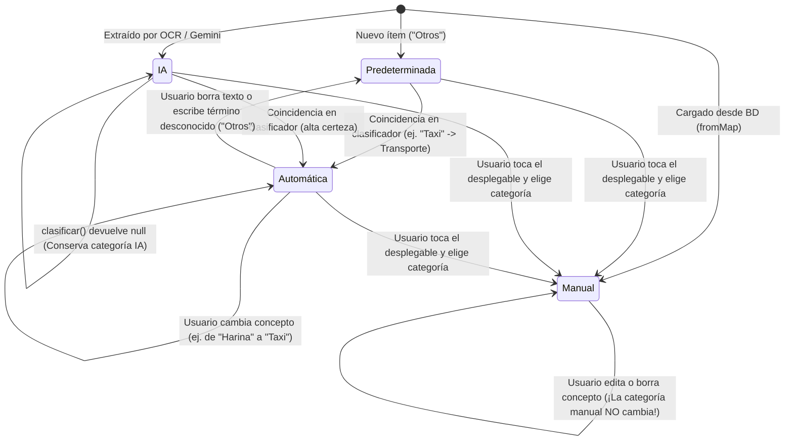

# Documento Técnico: Autocategorización Semántica Local de Conceptos (UI-14)

## 1. Visión y Propósito
El módulo de Autocategorización Semántica Local (`CategoryClassifierService`) permite que al registrar o editar un gasto manualmente en `ReviewExpenseScreen`, la aplicación deduzca y asigne automáticamente la categoría correspondiente a partir del texto ingresado en el campo **Concepto** (ej. "Harina PAN" $\rightarrow$ Alimentación, "Taxi" $\rightarrow$ Transporte, "Recarga Digitel" $\rightarrow$ Servicios).

### Principios de Diseño
1. **100% Local y Determinista:** Cero peticiones de red, cero llamadas al Cloudflare Worker y cero consumo de cuota de la API de Google Gemini. Todo se resuelve en memoria mediante un índice invertido hash $O(1)$ con latencia inferior a 0,1 ms.
2. **Máquina de Estados No Invasiva:** Se implementa el enum `OrigenCategoria` (`predeterminada`, `ia`, `automatica`, `manual`). La app nunca discute con el usuario: si una categoría fue seleccionada a mano en el desplegable (`manual`), jamás es sobreescrita por el clasificador.
3. **Protección de Extracciones de IA:** Las categorías detectadas por Gemini al escanear facturas (`origen: ia`) no se degradan a `'Otros'` si el usuario ajusta el texto y el clasificador devuelve `null`.
4. **Desambiguación Temática:** Frases compuestas prioritarias ("aceite de motor" vs "aceite de maíz", "papel higiénico" vs "papel bond") y conjunto explícito de términos ambiguos (`_ambiguos`) para no forzar categorías ante palabras sueltas como "aceite", "gas" o "batería".

---

## 2. Máquina de Estados de Categoría (`OrigenCategoria`)

### Reglas de Transición
- **De `predeterminada` a `automatica`:** Cuando el concepto coincide con el catálogo.
- **De `automatica` a `predeterminada`:** Si el usuario borra el concepto o escribe algo irreconocible, regresa a `'Otros'`.
- **De `ia` a `automatica`:** Si el usuario modifica el texto y coincide con una regla inequívoca del catálogo.
- **De `ia` a `ia`:** Si el usuario modifica el texto y el clasificador devuelve `null`, la categoría original de la IA **se preserva intacta**.
- **Cualquier estado a `manual`:** En cuanto el usuario interactúa con el `DropdownButtonFormField`, el ítem queda bloqueado con `OrigenCategoria.manual`.

---

## 3. Arquitectura y Componentes

### 3.1 `CategoryClassifierService` (`lib/services/category_classifier_service.dart`)
- **Catálogo Temático:** Más de 250 términos curados distribuidos estrictamente en las 10 categorías canónicas de `AppConstants.categorias`.
- **Mapeo Diacrítico Seguro:** Se normalizan acentos (`á` $\rightarrow$ `a`, `é` $\rightarrow$ `e`, `í` $\rightarrow$ `i`, `ó` $\rightarrow$ `o`, `ú` $\rightarrow$ `u`, `ü` $\rightarrow$ `u`, `ñ` $\rightarrow$ `n`) antes de aplicar sanitización de caracteres no alfanuméricos, garantizando que palabras como "jamón", "piña" o "año" no pierdan letras.
- **Evaluación de Frases Compuestas:** Búsqueda con límites de palabra (`\bfrase\b`) antes de evaluar tokens sueltos.
- **Filtro de Ambigüedad:** Si el texto normalizado contiene únicamente un término del conjunto `_ambiguos` (ej. "aceite", "gas", "batería", "crema", "pasta", "papel", "corte", "taller", "bar", "agua"), devuelve `null` para mantener `'Otros'`.

### 3.2 Unificación con Fallback de Voz (`GeminiService`)
El bloque de expresiones regulares duplicadas en `_parseVoiceExpenseLocalFallback` (`gemini_service.dart:554-575`) fue eliminado, delegando directamente en `CategoryClassifierService.clasificar(producto)`. Se preserva la retrocompatibilidad con las pruebas unitarias existentes (`queso`, `jamón`, `carne` $\rightarrow$ `Alimentación`).

### 3.3 Sincronización de Impuestos (`_sincronizarCategoriaImpuestos`)
Se extrajo la lógica de actualización de renglones impositivos (IVA e IGTF) en `ReviewExpenseScreen`. Cuando un ítem se reclasifica (automática o manualmente), los renglones impositivos adoptan de inmediato la categoría dominante de la factura calculada por `ItemGastoModel.calcularCategoriaDominante(_items)`.

### 3.4 Identidad Estable de Widgets (`clientKey`)
Cada `ItemGastoModel` cuenta con una clave en memoria generada mediante contador atómico (`it_${++_clientKeySeq}`). El widget `Card` de cada artículo utiliza `ValueKey('item_card_${item.clientKey}')`, asegurando que la adición o eliminación de ítems no desplace ni corrompa el estado interno de los `TextFormField`.

---

## 4. Matriz de Pruebas Automatizadas
1. **Unitarias del Clasificador (`category_classifier_service_test.dart`):**
   - Cobertura de las 10 categorías canónicas.
   - Normalización de tildes, eñes y caracteres especiales.
   - Frases compuestas y desambiguación.
   - Retorno de `null` para términos ambiguos aislados.
   - Límites de palabra (evitar "pan" dentro de "pantalón").
2. **De Widgets en Formulario (`review_expense_screen_layout_test.dart`):**
   - Autocategorización en tiempo real.
   - Reclasificación dinámica entre categorías automáticas sin quedar atrapado.
   - Reversión a 'Otros' al vaciar el campo concepto.
   - Protección total e inmutable ante selección manual.
3. **No Regresión de Voz (`voice_expense_sheet_test.dart`):**
   - Confirmación de inferencia correcta en dictado por voz.
