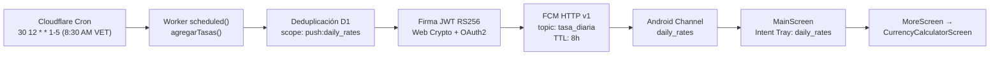

# Notificación Diaria de Tasa de Cambio (RET-02)

> **Estado:** `Implementada 🔧` (pendiente verificación de CI, despliegue del Worker con secreto FCM y validación en dispositivo por César).

## 1. Resumen Ejecutivo

**Rinde Más** envía un aviso automático de **lunes a viernes a las 8:30 a. m. (hora VE, UTC-4)** con las tasas reales del día (`USD BCV` y `USDT P2P`). Al tocar la notificación, la app abre directamente la **Calculadora de divisas** (`CurrencyCalculatorScreen`) y actualiza tasas si estaban vencidas.

El sistema cuesta **\$0** (plan gratuito de Cloudflare Workers Cron + Firebase Cloud Messaging HTTP v1 sobre Firebase Spark) y no añade dependencias nativas ni permisos nuevos a la app.

## 2. Arquitectura del Flujo



## 3. Componentes Modificados

| Capa | Archivo | Responsabilidad |
| :--- | :--- | :--- |
| **Worker (Cron + FCM)** | `workers/src/daily_rates_push.js` | Formatea tasas (`Bs. 245,30`), arma payload FCM v1 con TTL de 8 h, firma JWT RS256 con Web Crypto, obtiene token OAuth2 y deduplica por día VE en D1 (`push:daily_rates`). |
| **Worker (Entry + Cron)** | `workers/src/index.js`, `workers/wrangler.toml` | Registra `scheduled(event, env, ctx)` usando `ctx.waitUntil` y el trigger `crons = ["30 12 * * 1-5"]`. |
| **Constantes Flutter** | `lib/core/constants/app_constants.dart` | Define ID `1005`, canal `daily_rates`, topic `tasa_diaria`, payload `daily_rates` y preferencia `tasa_diaria_notificacion_activa`. |
| **Servicio Notificaciones** | `lib/services/notification_service.dart` | Pre-crea canales Android (`daily_rates` y `broadcast_announcements`), gestiona suscripción/desuscripción a `tasa_diaria`, enruta mensajes en primer plano al canal correcto y corrige doble emisión en `enqueueAction`. |
| **Preferencias** | `lib/providers/settings_provider.dart` | Expone `tasaDiariaActiva` (activo por defecto) y `setTasaDiariaActiva(bool)` con persistencia en `SharedPreferences`. |
| **Interfaz y Deep-Link** | `lib/ui/screens/more_screen.dart`, `lib/ui/screens/main_screen.dart` | Añade el switch `Tasa de cambio diaria` en `Más → Preferencias y datos → Notificaciones y avisos` y abre `CurrencyCalculatorScreen` al consumir el payload `daily_rates`. |

## 4. Formato de la Notificación Enviada

- **Título (1.ª línea en pantalla de bloqueo):** `Tasa de hoy · USD BCV Bs. 245,30`
- **Cuerpo (2.ª línea):** `USDT P2P Bs. 279,40 · Toca para calcular`
- **Degradación elegante:** si falta una de las dos monedas (`USD BCV` o `USDT P2P`), muestra la disponible en la 1.ª línea y `Toca para abrir la calculadora.` en la 2.ª. Si faltan ambas, el Worker omite el envío.
- **Protección contra tasas viejas:** `ttl: 28800s` (8 horas) y `collapse_key: daily_rates` (reemplaza cualquier aviso anterior sin apilar).

## 5. Activación en Cloudflare Workers (Paso Único de César)

El Worker omite el envío sin error si todavía no existe el secreto `FIREBASE_SERVICE_ACCOUNT_JSON`. Para activarlo en producción:

1. Abre **Firebase Console** → proyecto **Rinde Más (`gastoscan-ai`)** → **Configuración del proyecto (⚙️)** → pestaña **Cuentas de servicio**.
2. Haz clic en **Generar nueva clave privada** (o crea una cuenta de servicio dedicada en Google Cloud IAM con el rol **Administrador de la API de Firebase Cloud Messaging** / `roles/firebasecloudmessaging.admin`) y descarga el archivo `.json`.
3. **Nunca** guardes ese `.json` dentro del repositorio Git.
4. Sube el contenido completo del JSON como secreto cifrado en Cloudflare desde PowerShell (sin guardar el secreto en git):
   ```powershell
   Get-Content -Raw -Encoding UTF8 "C:\ruta\a\service-account.json" | npx wrangler secret put FIREBASE_SERVICE_ACCOUNT_JSON --config workers/wrangler.toml
   ```
5. Despliega el Worker actualizado:
   ```powershell
   npx wrangler deploy --config workers/wrangler.toml
   ```
6. Borra el archivo `.json` descargado de tu carpeta de Descargas tras verificar el envío.

## 6. Guía de Pruebas en Dispositivo Físico

> **Artefacto a probar:** commit `1106d4f` (`v1.6.0+5`, run `45442129304`, build `735`). En este run pasaron `flutter analyze`, 828/828 pruebas y `app-release-aab`, pero el runner de GitHub se desconectó en el paso #19 (`rindemas-dev-apk`). Re-ejecuta el run en GitHub Actions para descargar `rindemas-dev-apk`.

### Controles reales verificados en `lib/ui/`
- Entrada al grupo de preferencias: pestaña **Más** → `Preferencias y datos` (`Key('more_group_preferences')`, [`lib/ui/screens/more_screen.dart:860-873`](../lib/ui/screens/more_screen.dart)).
- Entrada al modal de notificaciones: `Notificaciones y avisos` (`Key('more_menu_notifications')`, [`lib/ui/screens/more_screen.dart:1053-1064`](../lib/ui/screens/more_screen.dart)).
- Switch del ajuste: `Tasa de cambio diaria` (`Key('switch_notif_tasa_diaria')`, [`lib/ui/screens/more_screen.dart:1681-1698`](../lib/ui/screens/more_screen.dart)).
- Enrutamiento por payload `daily_rates`: [`lib/ui/screens/main_screen.dart:264-305`](../lib/ui/screens/main_screen.dart) → `openCurrencyCalculator()` ([`lib/ui/screens/more_screen.dart:223`](../lib/ui/screens/more_screen.dart)) → `CurrencyCalculatorScreen` ([`lib/ui/screens/currency_calculator_screen.dart:16`](../lib/ui/screens/currency_calculator_screen.dart)).

### Escenarios de validación
1. **Switch en `Más → Preferencias y datos → Notificaciones y avisos`:**
   - Abre **Rinde Más Dev** → pestaña **Más** → toca **Preferencias y datos** → toca **Notificaciones y avisos**.
   - Verifica que aparece **Tasa de cambio diaria** activado por defecto en la primera posición.
   - Apágalo, cierra el modal, reinicia la app y vuelve a abrir el modal: debe mantenerse apagado. Vuelve a activarlo.
2. **Canal Android creado:**
   - En Android: **Ajustes del sistema → Apps → Rinde Más Dev → Notificaciones**.
   - Verifica que aparece el canal **Tasa de cambio diaria**.
3. **Prueba end-to-end del deep-link (sin esperar a las 8:30 a. m.):**
   - En **Firebase Console → Mensajería → Nueva campaña → Notificaciones de Firebase**:
     - Título: `Tasa de hoy · USD BCV Bs. 245,30`
     - Texto: `USDT P2P Bs. 279,40 · Toca para calcular`
     - Segmentación → **Tema**: `tasa_diaria`
     - Opciones adicionales → **Datos personalizados**: clave `payload`, valor `daily_rates`; clave `channel_id`, valor `daily_rates`.
     - Canal de notificaciones de Android: `daily_rates`.
   - Prueba con la app **en primer plano**, **en segundo plano** y **cerrada (cold start)**.
   - Al tocar la notificación en los 3 estados, la app debe abrir directamente la **Calculadora de divisas**. Al pulsar Atrás, vuelve a **Más** y luego a **Inicio**.
4. **Prueba del envío automático del Worker:**
   - Tras cargar `FIREBASE_SERVICE_ACCOUNT_JSON` y desplegar el Worker, confirma en **Cloudflare Dashboard → Workers → `rindemas-gateway` → Triggers → Cron Triggers** que figura `30 12 * * 1-5` y verifica la llegada real el próximo día hábil a las 8:30 a. m. VET (revisa los logs JSON `daily_rates_push_sent` en Observability).
