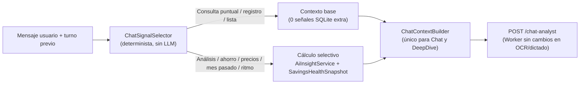

# Auditoría y Diseño Técnico: Asistente IA Contextual — Etapa 0 (`AI-11`)

> **Estado:** `Pendiente de validación 🧪` (CI en verde: APK build `743` run `45884706786`, Web build `37` run `45884706743`, Reglas build `10` run `45884707429`, SHA `1cc1772`; falta prueba manual de 6 prompts en dispositivo físico por César).  
> **Alcance:** Etapa 0 — Inteligencia financiera local (unificación de señales `AI-08`, coherencia fiscal `AI-06`, contexto temporal determinista, selector de señales y paridad en Worker + Panel Web).  
> **Etapas posteriores (diseño separado):** Etapa 1 (contexto venezolano estructurado en `insight_inicio` + `Consultar ->`) y Etapa 2 (investigadora asistida con fuentes oficiales fijas + PR, post-Google Play).

---

## 1. Resumen Ejecutivo de la Auditoría

Al auditar los cuatro puntos que hoy construyen contexto para `/chat-analyst`, se detectaron **cinco brechas concretas** en el código actual:

1. **Asimetría entre Inicio y Chat normal:** `ChatScreen._runInsightDeepDive` (`lib/ui/screens/chat_screen.dart:161-173`) inyecta `AiInsightService.computeHiddenSignals`, pero `ChatScreen._sendMessage` (`lib/ui/screens/chat_screen.dart:677-681`) **no las calcula ni las envía**. El Chat normal sabe menos que la tarjeta de Inicio.
2. **Desalineación fiscal (`AI-06`) y de agrupación en productos:** `DatabaseHelper.findPriceHistory` (`lib/data/datasources/local/database_helper.dart:1326-1335`) normaliza facturas heredadas `(G)`/`(R)` con `shelfPriceTaxFactor`. Sin embargo, `top_productos_mes` (`chat_screen.dart:575-586`) y `top_productos_sin_iva` (`ai_insight_service.dart:735-742`) agrupan por `toLowerCase()` en vez de `normalizeProductText` y omiten `shelfPriceFactorForCurrentItems`. Esto divide variantes del mismo producto y subestima ~16% ítems gravados en facturas anteriores a `AI-06`.
3. **Proyecciones sin guarda de confianza ni metadatos temporales:** `SavingsHealthCalculator.calculate` (`lib/domain/finance/savings_health_calculator.dart:11-51`) ya calcula `diasTranscurridos`, `diasTotalesMes`, `gastoDiarioPromedio` y usa `diasGraciaInicioMes = 3`. Sin embargo, `chat_screen.dart:635` envía `gasto_proyectado_fin_mes` incluso en los días 1–3 y sin indicar días transcurridos ni confiabilidad.
4. **Ceguera de mes seleccionado, moneda principal y orden de productos:** `_buildSemanticChatContext` (`chat_screen.dart:591-644`) ordena `top_productos_mes` por `cantidad` en lugar de `total_usd`, omite `moneda_principal` (el Worker cae a `"USD"` en `workers/src/index.js:873`), omite `top_comercios` y no envía `periodo_consultado` (si el usuario consulta un mes pasado, Gemini solo ve `fecha_hoy`). Además, Flutter usa `DateTime.now()` local en lugar de hora de Venezuela (`UTC-4`).
5. **Paridad y deuda en Panel Web:** `landing/src/lib/ai-assistant.js:456` todavía envía `brecha_capturada`, señal retirada en Flutter durante `AI-08` (`.agents/rules/ia-ocr-voz.md` §3).

---

## 2. Matriz Comparativa del Estado Actual

| Dato / Señal | `insight_inicio` (`ai_insight_service.dart:751`) | `Consultar ->` (`chat_screen.dart:151`) | Chat normal (`chat_screen.dart:677`) | Panel Web (`ai-assistant.js:442`) |
| :--- | :---: | :---: | :---: | :---: |
| `comparativa_mes_anterior` (`AI-08`) | ✅ | ✅ | ❌ | ❌ |
| `diferencias_precios` 60 días (`AI-08`) | ✅ | ✅ | ❌ | ❌ |
| `gastos_hormiga` `< $10` (`AI-08`) | ✅ | ✅ | ❌ | ❌ |
| `top_comercios` (top 3) | ✅ | ❌ | ❌ | ❌ |
| `moneda_principal` | ✅ | ❌ (fallback `"USD"`) | ❌ (fallback `"USD"`) | ✅ |
| Orden `top_productos` por `total_usd` | ✅ | ❌ (por `cantidad`) | ❌ (por `cantidad`) | ❌ (por `cantidad`) |
| Normalización `normalizeProductText` + IVA `AI-06` | ❌ | ❌ | ❌ | ❌ |
| `fecha_hoy` en Venezuela (`UTC-4`) | ❌ (`DateTime.now()`) | ❌ (`DateTime.now()`) | ❌ (`DateTime.now()`) | ✅ (`America/Caracas`) |
| `periodo_consultado` (`YYYY-MM`) | ❌ | ❌ | ❌ | ❌ |
| `proyeccion_confiable` + ritmo diario | ❌ | ❌ | ❌ | ❌ |
| Libre de `brecha_capturada` | ✅ | ✅ | ✅ | ❌ (línea 456) |

---

## 3. Arquitectura Propuesta para Etapa 0

### Principios y Restricciones
- **Regla de Oro de IA:** El código determinista calcula; Gemini interpreta y redacta.
- **Fuente única de verdad:** No duplicar cálculos de `AI-08`, `SavingsHealthCalculator` ni `shelfPriceFactorForCurrentItems`.
- **Cero infraestructura nueva:** Sin D1, KV, RAG, embeddings ni búsquedas web.
- **Exclusiones estrictas:** No alterar `/analyze-receipt` (OCR) ni `modo: "dictado_gasto"`.
- **Sin suposiciones de ingresos:** No asumir pagos quincenales universales los días 15 y 30.

### Flujo de Datos



---

## 4. Contratos de Datos Propuestos

### 4.1 Hora de Venezuela Única (`UTC-4`)
Crear un helper puro en Dart (`venezuelaNow(DateTime? now)`) equivalente a `VET_OFFSET_MS` en `workers/src/index.js:55-58` y `getVenezuelaTodayIso` en `landing/src/lib/ai-assistant.js:55-68`:
- `DateTime.now().toUtc().subtract(const Duration(hours: 4))` (Venezuela no usa horario de verano).
- Usarlo como única ancla para `fecha_hoy`, `diaActual`, `comparativa_mes_anterior` y `findPriceHistory`.

### 4.2 Bloque `contexto_temporal` (Fuente única: `SavingsHealthSnapshot`)
Se construye directamente desde `GastoProvider.savingsSnapshot` y el mes seleccionado:

```json
{
  "fecha_hoy_ve": "2026-11-21",
  "periodo_consultado": "2026-11",
  "es_mes_actual": true,
  "dias_transcurridos": 21,
  "dias_totales_mes": 30,
  "porcentaje_mes_transcurrido": 70,
  "dias_restantes_mes": 9,
  "es_cierre_de_mes": false,
  "cantidad_compras_mes": 18,
  "moneda_presupuesto": "USD",
  "gasto_diario_promedio": 14.25,
  "proyeccion_confiable": true,
  "gasto_proyectado_fin_mes": 427.50,
  "motivo_sin_proyeccion": null
}
```

**Regla estricta contra proyecciones falsas:**
- `proyeccion_confiable = es_mes_actual && dias_transcurridos > 3 && cantidad_compras_mes >= 3` (reutilizando `diasGraciaInicioMes = 3` de `SavingsHealthCalculator`).
- Si `proyeccion_confiable == false`:
  - `gasto_proyectado_fin_mes` se envía como `null` (también en el campo raíz para evitar contradicciones).
  - `motivo_sin_proyeccion` toma uno de tres valores cerrados: `"mes_cerrado"`, `"inicio_de_mes"` (`dias_transcurridos <= 3`) o `"pocos_gastos"` (`cantidad_compras_mes < 3`).
- `es_cierre_de_mes = es_mes_actual && dias_restantes_mes <= 3`.
- **Fechas calculables de calendario (base pura):** El helper expondrá también una función pura de calendario (`computeCalculableMilestones(DateTime vetDate)`) preparada para **Etapa 1** (Black Friday = viernes posterior al 4.º jueves de noviembre; fin de mes; inicio de año). En **Etapa 0** solo se expone `es_cierre_de_mes`; las narrativas comerciales y feriados quedan reservados para Etapa 1.

### 4.3 Normalización de `top_productos_mes` y `top_comercios`
En el constructor compartido (`ChatContextBuilder`, reutilizable desde `AiInsightService` y `ChatScreen`):
1. Agrupar ítems por `DatabaseHelper.normalizeProductText(item.descripcion)` (conservando el nombre legible más reciente).
2. Ajustar cada ítem con `DatabaseHelper.shelfPriceFactorForCurrentItems(targetItem: item, allItems: g.items)` antes de convertirlo a USD:
   - En facturas post-`AI-06` (`baseImponibleOriginal != null`), el factor es `1.0` (ya incluye IVA).
   - En facturas legadas con renglón de IVA separado, aplica `1.16` o `1.08` de forma simétrica al comparador de 60 días.
3. Ordenar `top_productos_mes` por **`total_usd` descendente** (top 10 en Chat, top 5 en `insight_inicio`).
4. Incluir `top_comercios` (top 3 por `total_usd`) también en el contexto del Chat.
5. Incluir siempre `moneda_principal` desde `SettingsProvider` / moneda activa del presupuesto.

### 4.4 Metadatos en `AiHiddenSignals` (Sin duplicar cálculos)
`AiInsightService.computeHiddenSignals` se mantiene como motor único, añadiendo parámetros booleanos opcionales para evitar consultas SQLite innecesarias:
- `includeAntExpenses = true`
- `includePrevMonthComparison = true`
- `includePriceFindings = true`

Y añade metadatos de período y moneda en sus salidas:
- `comparativa_mes_anterior`: incluir `periodo_actual` (`"2026-11-01..2026-11-21"`), `periodo_anterior` (`"2026-10-01..2026-10-21"`), `moneda: "USD"` y `comparacion_parcial: true`.
- `diferencias_precios`: incluir `ventana_dias: 60` y `moneda: "USD"`.
- `gastos_hormiga`: incluir `umbral_usd: 10.0` y `moneda: "USD"`.

---

## 5. Selector Determinista de Señales (`ChatSignalSelector`)

El selector corre en Dart **antes** de consultar SQLite (cero llamadas extra a Gemini, cero consultas innecesarias a DB). Recibe:
- `currentMessage` (texto del turno actual)
- `previousUserMessage` (para mantener contexto en repreguntas cortas como *"¿y por qué?"* o *"detállalo"*)
- `forceAllSignals` (`true` exclusivamente en `_runInsightDeepDive`)
- `knownProductNames` (opcional, para detectar preguntas sobre un producto ya comprado)

| Intención detectada | Patrones de ejemplo | Señales incluidas | SQLite extra |
| :--- | :--- | :--- | :---: |
| **A. Acción / Lista / Consulta puntual** | `compré`, `gasté $5`, `anota`, `lista de compras`, `cuánto gasté en [categoría/comercio]` | Ninguna señal oculta; solo contexto base | ❌ |
| **B. Comparativa mensual** | `mes pasado`, `mes anterior`, `subió`, `bajó`, `más que antes`, `comparar` | `comparativa_mes_anterior` + `contexto_temporal` | Solo `getGastosByMonth` |
| **C. Precios y comercios** | `más barato`, `más caro`, `precio`, `subido de precio`, `dónde comprar`, producto conocido + `precio`/`caro`/`barato` | `diferencias_precios` + `top_comercios` | Solo `findPriceHistory` |
| **D. Gastos hormiga** | `hormiga`, `pequeños`, `pequeñas`, `fugas`, `chucherías`, `café`, `menores` | `gastos_hormiga` | En memoria (0 SQL) |
| **E. Ahorro / Ritmo / Diagnóstico general** | `ahorrar`, `reducir`, `recortar`, `presupuesto`, `ritmo`, `en qué se me va`, `alcanza`, `resumen`, `consejo`, `diciembre`, `planificar`, o `forceAllSignals == true` | Todas las señales disponibles + `contexto_temporal` | Completo |
| **F. Repregunta corta** | `<= 5` palabras (`¿por qué?`, `dime más`, `explícame`, `¿cuáles?`) | Hereda la selección del turno anterior del usuario | Según turno previo |
| **G. Consulta neutra / otra** | Conversación general no clasificada | Solo `contexto_temporal` (sin señales ocultas) | ❌ |

---

## 6. Ajustes del Prompt en el Worker (`workers/src/index.js`)

Sin modificar `/analyze-receipt` ni `modo: "dictado_gasto"`, en el prompt del Chat normal (`workers/src/index.js:956-1016`) se añaden **4 reglas breves (~75 tokens)**:
1. **Respetar `contexto_temporal`:** Usar `periodo_consultado` como mes analizado; nunca proyectar gasto a fin de mes cuando `proyeccion_confiable` sea `false` (explicar que aún faltan días o compras suficientes).
2. **Respetar comparaciones parciales:** Si existe `comparativa_mes_anterior`, aclarar siempre que compara del día 1 al `dia_corte` contra el mismo tramo del mes anterior.
3. **No inventar señales ausentes:** Si `diferencias_precios`, `gastos_hormiga` o `comparativa_mes_anterior` no están en el JSON, no suponer que existen ni inventar porcentajes.
4. **Cero menciones espontáneas fuera de tema:** Si el usuario hizo una consulta puntual (monto de una categoría o comercio), responder solo ese dato sin añadir consejos no pedidos.

---

## 7. Impacto Estimado en Tokens

| Escenario de consulta | Payload actual | Payload Etapa 0 | Diferencia |
| :--- | :---: | :---: | :---: |
| Consulta puntual / registro / lista (Grupo A) | ~520 tokens | ~540 tokens (+`moneda_principal`, `periodo_consultado`) | **+20 tokens (~4%)** |
| Pregunta de gastos hormiga (Grupo D) | ~520 tokens | ~610 tokens | **+90 tokens** |
| Pregunta de comparativa mensual (Grupo B) | ~520 tokens | ~650 tokens | **+130 tokens** |
| Pregunta de precios (Grupo C) | ~520 tokens | ~680 tokens | **+160 tokens** |
| Ahorro / diagnóstico completo (Grupo E) | ~520 tokens | ~790 tokens (+75 prompt) | **+270–345 tokens** |
| OCR (`/analyze-receipt`) y `dictado_gasto` | Sin cambio | Sin cambio | **0 tokens** |

*Nota BYOK:* El recorte en Grupo A protege directamente el saldo compartido y las claves personalizadas de los usuarios cuando solo consultan montos o gestionan su lista.

---

## 8. Archivos Afectados en la Implementación (Referencia)

| Archivo | Cambio previsto en Etapa 0 |
| :--- | :--- |
| `lib/services/chat_signal_selector.dart` *(nuevo)* | Selector determinista de intenciones (`ChatSignalSelection`) + manejo de repreguntas cortas. |
| `lib/services/chat_context_builder.dart` *(nuevo)* | Constructor único de `contexto_temporal`, `top_productos_mes` (con `normalizeProductText` + `shelfPriceFactorForCurrentItems`, orden `total_usd`) y `top_comercios` en `UTC-4`. |
| `lib/services/ai_insight_service.dart` | Añadir flags `include*` a `computeHiddenSignals`, metadatos de período/moneda en señales y reutilizar normalización de productos. |
| `lib/ui/screens/chat_screen.dart` | Unificar `_runInsightDeepDive` y `_sendMessage` sobre `ChatContextBuilder` + `ChatSignalSelector`. |
| `workers/src/index.js` | Añadir las 4 reglas de interpretación de `contexto_temporal` y señales en el Chat normal (sin tocar OCR ni `dictado_gasto`). |
| `landing/src/lib/ai-assistant.js` *(con aprobación de César)* | Retirar `brecha_capturada` (línea 456) y alinear `contexto_temporal` + orden de `top_productos_mes` por `total_usd`. |

---

## 9. Plan de Pruebas de Regresión (20 Casos Deterministas + 6 Prompts en Vivo)

### 9.1 Pruebas Unitarias Deterministas (Flutter CI — 0 tokens)
1. **5 casos de consultas directas / acción (0 señales ocultas):**
   - *"¿Cuánto gasté en pan?"*
   - *"¿Cuánto gasté en farmacia este mes?"*
   - *"Compré 5$ de queso en Unimarket"*
   - *"Agrega leche y café a la lista de compras"*
   - *"¿Qué tengo pendiente en mi lista?"*
2. **5 casos de análisis específico (solo la señal correspondiente):**
   - *"¿Estoy gastando más que el mes pasado?"* → solo `comparativa_mes_anterior` + `contexto_temporal`.
   - *"¿Dónde me salió más barato el café?"* → solo `diferencias_precios` + `top_comercios`.
   - *"¿Qué gastos pequeños están sumando más?"* → solo `gastos_hormiga`.
   - *"¿Voy muy rápido con el presupuesto este mes?"* → `contexto_temporal` + todas las señales relevantes.
   - *"¿En qué se me está yendo el dinero y cómo ahorro?"* → todas las señales disponibles.
3. **5 casos de integridad temporal y fiscal (`AI-06` + `SavingsHealthCalculator`):**
   - Día 2 del mes con \$200 gastados → `proyeccion_confiable: false`, `gasto_proyectado_fin_mes: null`, `motivo_sin_proyeccion: "inicio_de_mes"`.
   - Día 15 del mes con solo 2 gastos → `proyeccion_confiable: false`, `motivo_sin_proyeccion: "pocos_gastos"`.
   - Mes pasado seleccionado (ej. octubre estando en noviembre) → `es_mes_actual: false`, `periodo_consultado: "2026-10"`, `motivo_sin_proyeccion: "mes_cerrado"`.
   - Factura legada `(G)` con línea `IVA 16%` separada vs. factura `AI-06` imputada → mismo producto agrupado en una sola entrada de `top_productos_mes` con monto comparable `Con IVA`.
   - Fecha calculada a las 22:30 UTC-4 (02:30 UTC del día siguiente) → `fecha_hoy_ve` conserva el día de Venezuela.
4. **5 casos borde y continuidad conversacional:**
   - Repregunta *"¿y por qué?"* después de *"¿estoy gastando más que el mes pasado?"* → hereda `comparativa_mes_anterior`.
   - `_runInsightDeepDive` (`forceAllSignals: true`) → mantiene comportamiento completo de `AI-08`.
   - Mes sin historial previo en SQLite → omite `comparativa_mes_anterior` limpiamente sin fallar.
   - `top_productos_mes` con 10 chicles de \$0,20 vs. 1 carne de \$35 → carne aparece primero (orden por `total_usd`).
   - Exclusión intacta de ítems fiscales (`isTaxItem`) en `top_productos_mes` y `gastos_hormiga`.

### 9.2 Validación Manual Contra Gemini Real (6 Prompts Post-Deploy)
**Build y artefactos verificados en CI:**
- **Commit SHA:** `1cc1772`
- **APK Android:** Build `743` (run `45884706786`, `conclusion: success`)
- **Panel Web:** Build `37` (run `45884706743`, `conclusion: success`, `https://rindemas.cesarluis.com/panel`)
- **Reglas Firestore:** Build `10` (run `45884707429`, `conclusion: success`)
- **Cloudflare Worker (`rindemas-gateway`):** Desplegado en producción (`Version ID: 9782e792-cda7-4d08-894d-d1b89697bb1e`) con `buildChatSystemPrompt` (Etapa 0) y `quotaDayFor()`.

**Rutas y controles reales verificados en `lib/ui/`:**
- **Acceso al Chat desde cualquier pestaña principal:** Botón `✨` en AppBar abre `ChatScreen` en [`lib/ui/screens/main_screen.dart:776`](../lib/ui/screens/main_screen.dart#L776).
- **Acceso desde tarjeta Asistente IA en Inicio:** Botón `Consultar ->` (`Key('ai_insight_card_consultar_btn')`) en [`lib/ui/widgets/ai_insight_card.dart:224`](../lib/ui/widgets/ai_insight_card.dart#L224) abre `ChatScreen` (`línea 96`).
- **Controles de entrada en Chat (`lib/ui/screens/chat_screen.dart`):**
  - Chips de sugerencias: `Key('chat_suggestion_chip_$index')` (`línea 1458`).
  - Campo de texto del chat: `Key('chat_input_textfield')` (`línea 1498`).
  - Botón enviar: `Icon(Icons.send)` (`línea 1539`).

**Pruebas en dispositivo físico (*Rinde Más Dev*):**
1. *"¿Cuánto gasté en farmacia?"* → respuesta directa sin consejos no pedidos.
2. *"¿Qué gastos pequeños están sumando más?"* → cita el monto y comercio real de `gastos_hormiga` sin mencionar IVA.
3. *"¿Dónde me salió más barato [producto frecuente]?"* → cita precios reales del comparador de 60 días.
4. *"¿Estoy gastando más que el mes pasado?"* → aclara explícitamente la comparación del día 1 al día actual.
5. *"¿Me alcanza el presupuesto este mes?"* (en días 1–3 o con `< 3` gastos) → reconoce que aún hay pocos datos para proyectar.
6. *"¿Cómo puedo ahorrar este mes?"* → combina categorías, presupuesto y señales reales sin inventar ahorro por brecha BCV vs. USDT.

---

## 10. Criterios de Aceptación de Etapa 0
- [ ] Chat normal y `Consultar ->` comparten un único constructor de contexto y reciben señales `AI-08` según intención.
- [ ] Ninguna pregunta directa o registro de gasto dispara consultas SQLite de señales ocultas ni añade ruido en la respuesta.
- [ ] `top_productos_mes` unifica variantes con `normalizeProductText`, ordena por `total_usd` y aplica normalización fiscal `AI-06` sin falsas subidas del 16%.
- [ ] Nunca se envía proyección numérica cuando `dias_transcurridos <= 3`, `cantidad_compras_mes < 3` o el mes está cerrado.
- [ ] OCR y `dictado_gasto` mantienen exactamente 0 tokens adicionales.
- [ ] Suite completa de CI en verde (20+ tests nuevos de Etapa 0) + validación manual de los 6 prompts en dispositivo físico por César.
