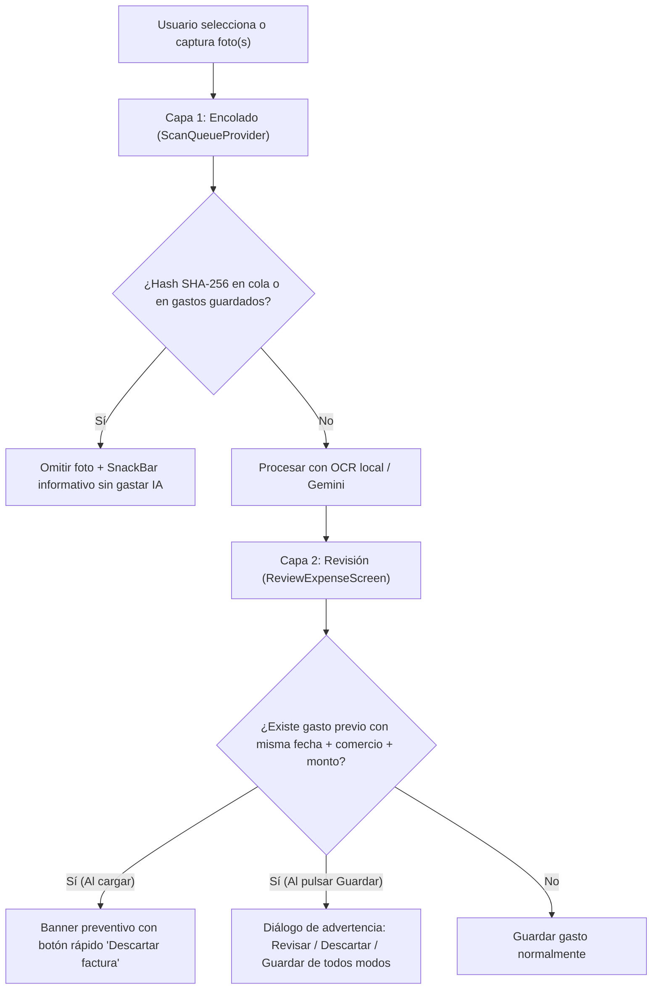

# Plan Técnico: Detección Preventiva de Fotos y Facturas Duplicadas (`AI-09`)

## 1. Contexto y Problema
En Rinde Más, un usuario puede seleccionar por descuido la misma imagen de una factura en momentos distintos, o tomar dos fotos consecutivas del mismo comprobante físico (con distinta iluminación o encuadre), o bien registrar manualmente un gasto que ya había escaneado previamente.

Actualmente:
* La cola de escaneo (`ScanQueueProvider`) únicamente detecta duplicados si el hash SHA-256 exacto se encuentra en `scan_queue` en estado activo (`pending`, `processing`, `ready`).
* Una vez que la factura es aprobada y guardada como gasto en SQLite (`gastos`), el ítem de `scan_queue` es eliminado (`deleteScanQueueItem`) y `gastos` no conserva el hash. Por ende, la misma foto vuelve a procesarse si se añade después.
* Si se toman dos fotos diferentes del mismo ticket o se crea un gasto manual idéntico, no existe ninguna verificación semántica por fecha, comercio o monto en `ReviewExpenseScreen` ni en `GastoProvider`.

---

## 2. Flujo de Control en Dos Capas

---

## 3. Especificación Técnica por Capas

### Capa 1: Encolado Temprano y Descarte de Hash (`ScanQueueProvider`)
1. **Verificación de hash persistente:**
   * Al recibir una imagen en `enqueue` o `enqueueMultiple`, se computa `ImageHashService.computeFileSha256(file)`.
   * Se comprueba no solo `isImageHashInScanQueue(hash)`, sino también si ya fue guardado en `gastos` (`isImageHashInGastos(hash)`).
2. **Retroalimentación inmediata:**
   * Se expone el conteo de duplicados omitidos en la invocación (`lastSkippedDuplicatesCount`).
   * En `main_screen.dart` y `scan_screen.dart`, se presenta un `SnackBar` conciso según la regla de ciclo de vida terminológico (`.agents/rules/marca-terminologia.md` §3 - Pre-análisis usa término **"foto(s)"**):
     * *1 foto omitida:* `"Esta foto ya está en cola o ya fue registrada."`
     * *Lote con omisiones:* `"Se omitieron X fotos duplicadas."`

### Capa 2: Detección Semántica en Revisión y Guardado (`ReviewExpenseScreen`)
1. **Método determinista `DatabaseHelper.findPossibleDuplicateGastos`:**
   * Busca gastos activos (`eliminado_en IS NULL` y excluyendo el `id` actual en modo edición) en la misma `fecha`.
   * Criterio de coincidencia de monto:
     * Si ambas monedas coinciden: `|total_original - nuevoTotalOriginal| <= 1` centavo.
     * Si difieren: `|total_usd - nuevoTotalUsd| <= 2` centavos (cuando el monto es $> 0$).
   * Criterio de coincidencia de comercio:
     * Normalización con `DatabaseHelper.normalizeCommerce`: si ambos son idénticos y no vacíos $\rightarrow$ duplicado.
     * Si ambos comercios son genéricos (`normalizeCommerce == ''`), se valida si comparten al menos un ítem con la misma `descripcion_norm`.
2. **Banner Informativo al Abrir:**
   * Si la pantalla abre desde cola IA (`widget.extractedData != null`), se ejecuta la verificación de inmediato.
   * Si detecta duplicado, muestra un banner superior:
     * *"Posible factura duplicada: ya registraste un gasto en [Comercio] por [Monto] el [Fecha]."*
     * Botón de acción rápida: *"Descartar factura"* (elimina de `scan_queue` y avanza a la siguiente factura del lote mediante `Navigator.pushReplacement`).
3. **Modal de Confirmación al Guardar:**
   * Si el usuario pulsa *"Guardar"* y el gasto final coincide con un registro previo:
     * `AlertDialog` con alto contraste:
       * **Título:** `¿Guardar factura duplicada?`
       * **Cuerpo:** `Ya registraste un gasto en [Comercio] el [Fecha] por [Monto]. ¿Deseas guardarlo de todos modos?`
       * **Acciones:** `Revisar` (volver a editar), `Descartar factura` (si proviene de cola) y `Guardar de todos modos` (botón primario amarillo con texto negro).

---

## 4. Opciones de Persistencia de Hash SQLite

* **Opción A (Migración v20):** Añadir columna `image_hash TEXT` a la tabla `gastos` con índice `idx_gastos_image_hash`. Al guardar un gasto proveniente de escaneo, se persiste el hash. (No se envía a Firestore, manteniéndose exclusivamente local).
* **Opción B (Sin migración):** Consultar las fotos locales activas en `ruta_foto_local` en tiempo de ejecución.

---

## 5. Plan de Pruebas y Validación

### Pruebas Automatizadas
1. `test/data/duplicate_expense_detection_test.dart`:
   * Prueba unitaria de `findPossibleDuplicateGastos` con comercios exactos, variaciones de RIF/C.A., fechas distintas y gastos eliminados.
   * Prueba de `isImageHashInGastos` con comprobantes almacenados y eliminados.
2. `test/providers/scan_queue_provider_test.dart`:
   * Prueba de rechazo en `enqueue` y `enqueueMultiple` cuando el hash ya existe en `gastos`.
3. Verificación de compilación y pruebas en CI mediante `scripts/wait_ci.ps1`.

### Pruebas en Dispositivo Físico
1. Guardar una factura escaneada.
2. Intentar seleccionar la misma foto desde la galería y comprobar el descarte inmediato y el SnackBar.
3. Tomar una segunda foto con encuadre distinto del mismo ticket y comprobar el banner preventivo y el diálogo al guardar.
