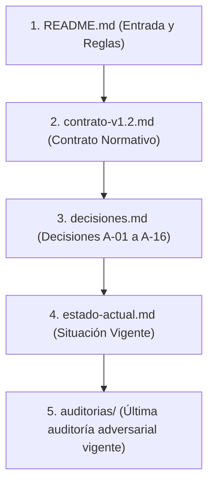

# RM-03 — Documentación Central y Persistente del Proyecto

> **Instrucción obligatoria para agentes (Gemini, DeepSeek y futuros agentes):**  
> «Antes de comenzar cualquier tarea RM-03, lee este README.md y todos los documentos que referencia. No solicites al usuario que vuelva a adjuntar información que ya esté registrada en esta carpeta. Actualiza la documentación al terminar tu tarea».

---

## 1. Propósito del Proyecto RM-03

**RM-03** tiene como propósito garantizar la **integridad financiera y monetaria** de Rinde Más (`AppConstants.appName`), erradicando de raíz la fabricación arbitraria de equivalencias y tasas de cambio en el entorno multimoneda de Venezuela (`VES`, `USD`, `USDT`, `EUR`).

El proyecto se rige por principios deterministas y de contención:
1. **El hecho pagado manda:** El importe original pagado (`total_original`) y su moneda de origen (`moneda`) son inmutables ante variaciones de tasas de cambio o ediciones de metadatos (comercio, categoría).
2. **Sin tasa no hay equivalencia:** Lo desconocido no se sustituye por cero ni por paridad 1:1 (`?? 1.0`, `?? totalUsd`, `?? tasaCambio`, `|| 1.0`). Si no se dispone de una tasa exacta o válida con procedencia certificada, el lente correspondiente se marca como pendiente o se bloquea el guardado.
3. **Paridad USD/USDT acotada:** La paridad 1:1 aplica estrictamente a pagos directos en divisa (`metodo_liquidacion == 'DIVISA'`) y a presupuestos; nunca se extiende a EUR ni a bolívares indexados sin tasa de mercado.
4. **Ningún proceso reescribe historia automáticamente:** Se neutralizan reparaciones automáticas silenciosas en background.

---

## 2. Ubicación de la Documentación y Archivos Clave

Toda la documentación técnica, contratos, decisiones y auditorías de RM-03 reside centralizada dentro del repositorio en:

📁 **`docs/rm-03/`**

| Archivo / Carpeta | Tipo de Documento | Propósito |
| :--- | :--- | :--- |
| [**`contrato-v1.2.md`**](file:///c:/Development/Control%20de%20gastos%20VE/docs/rm-03/contrato-v1.2.md) | **Contrato Normativo Definitivo** | Pliego técnico adjudicado de Fase 0A (`RM-03-fase-0-especificacion-adjudicada-v1.2.md`). Es la norma suprema e inmutable para cualquier desarrollo o validación. |
| [**`decisiones.md`**](file:///c:/Development/Control%20de%20gastos%20VE/docs/rm-03/decisiones.md) | **Decisiones Aprobadas** | Registro formal de las decisiones adjudicadas `A-01` a `A-16`, con su alcance, restricciones, fases y discrepancias documentadas. |
| [**`estado-actual.md`**](file:///c:/Development/Control%20de%20gastos%20VE/docs/rm-03/estado-actual.md) | **Estado Vigente de RM-03** | Estado operativo en tiempo real de las unidades (`E0-01` a `E0-05`), estado del working tree, bloqueantes pendientes y tareas autorizadas. |
| 📁 [**`auditorias/`**](file:///c:/Development/Control%20de%20gastos%20VE/docs/rm-03/auditorias/) | **Historial de Auditorías** | Registro cronológico inmutable de informes de auditorías adversariales independientes (DeepSeek) y parches de implementación (Gemini). |

---

## 3. Orden Obligatorio de Lectura

Todo agente que inicie o continúe labores en RM-03 debe consultar los documentos en este orden estricto:

---

## 4. Reglas Permanentes de Desarrollo y Mantenimiento

Todo agente que opere en este repositorio debe respetar de forma irrestricta las siguientes reglas operativas:

### 1. Inmutabilidad Normativa
- **El `contrato-v1.2.md` es inmutable:** No se puede alterar, relajar ni reescribir sin autorización explícita de César.
- **Las decisiones `A-01` a `A-16` no pueden reinterpretarse silenciosamente:** Cualquier cambio en una decisión aprobada requiere consulta previa y aprobación de César.
- **Prevalencia de instrucciones:** Las instrucciones específicas de una nueva tarea prevalecen sobre los permisos generales descritos en esta documentación.

### 2. Control de Cambios y Git
- **PROHIBIDO commits y push sin autorización expresa:** Ningún agente puede ejecutar `git commit` ni `git push` a menos que César lo haya autorizado de forma explícita e inequívoca en la sesión activa.
- **Entorno PowerShell Windows Seguro:** Prohibido encadenar comandos con `&&` (usar `;`) y prohibido usar el operador `>` (usar tuberías con `Out-File -Encoding utf8`).

### 3. Rigor de Validación y Pruebas
- **Obligación de distinguir pruebas inspeccionadas de pruebas ejecutadas:**
  - El SDK local de Flutter/Dart **NO está instalado** en la máquina del usuario.
  - Ninguna prueba se ejecuta en local salvo con arneses Node.js o mocks independientes. Todo build, análisis estático (`flutter analyze --fatal-warnings`) y pruebas (`flutter test`) se ejecutan exclusivamente en GitHub Actions CI.
  - **Prohibido declarar una prueba como ejecutada o superada por el simple hecho de que su código exista en el repositorio.** Si solo se revisó el archivo, debe registrarse explícitamente como "prueba inspeccionada", nunca como "prueba ejecutada".
- **No declarar garantías globales basadas en módulos aislados:** La contención de un módulo (ej. `RateQuoteInput` en `domain/monetary/`) no demuestra que el sistema completo esté protegido si los consumidores (`GastoModel`, `SettingsProvider`, `panel.astro`) no han sido integrados.
- **No usar reportes antiguos de CI como evidencia de un parche reciente:** Un resultado en verde de un commit previo no valida modificaciones realizadas posteriormente en el working tree local.

### 4. Ciclo de Documentación y Auditorías
- **Cada nueva auditoría debe guardarse como un archivo independiente dentro de `auditorias/`:** Nunca sobrescribir ni fusionar informes anteriores.
- **Cada implementación o parche debe producir un informe técnico independiente dentro de `auditorias/`:** Detallando archivos modificados, hallazgos resueltos, pruebas preparadas y riesgos residuales.
- **`estado-actual.md` debe actualizarse al terminar cada tarea:** Reflejando con total fidelidad el estado final alcanzado.
- **Conservar discrepancias:** Cuando dos auditorías o agentes discrepen, deben conservarse ambas conclusiones en el historial y registrar formalmente la discrepancia como un punto pendiente de resolución.
