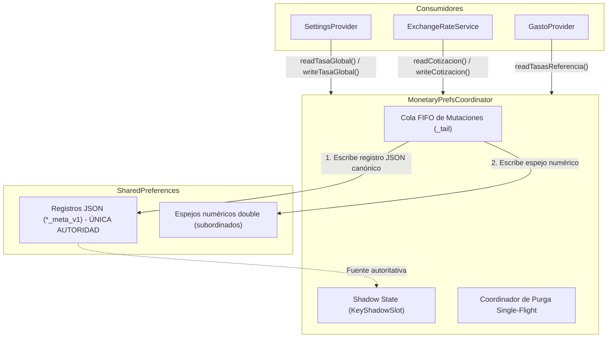
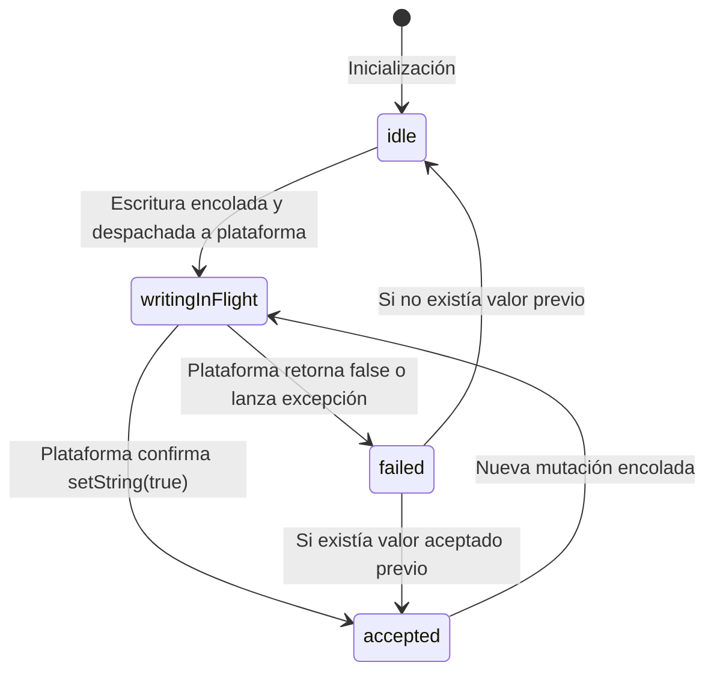
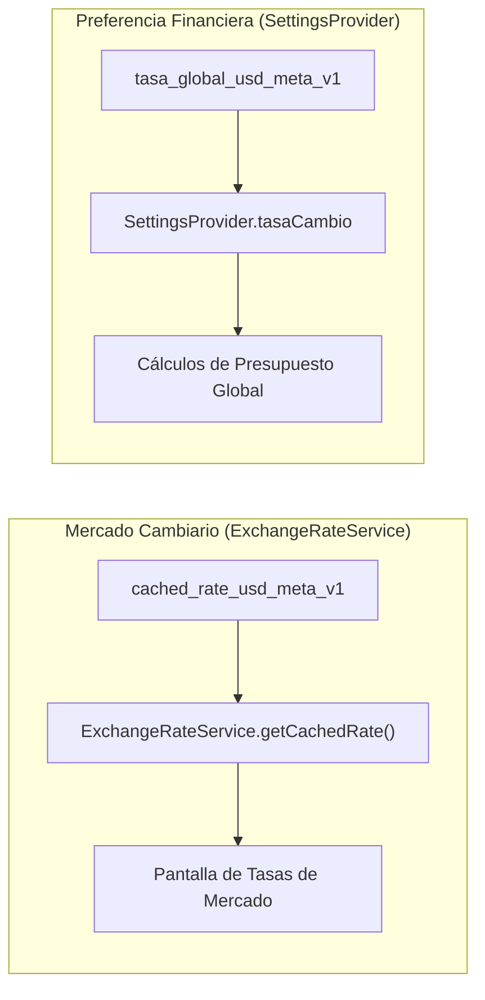

# RM-03 | E0-02 | Especificación Técnica Consolidada (Cierre U1/U2)

Esta especificación técnica constituye el diseño conceptual definitivo y autocontenido para cerrar las unidades U1 y U2 de la etapa E0-02 en Rinde Más.

El documento resuelve las contradicciones de las iteraciones anteriores, incorpora los 8 puntos de corrección de producto y concurrencia solicitados por César, y establece la arquitectura verificable para someter a auditoría.

---

## 1. Diagnóstico y causas raíz

### 1.1 Sustitución cruzada indebida USD $\rightarrow$ USDT (Violación de D-04)
- **Evidencia en código:**
  - `lib/services/exchange_rate_service.dart:178`: `final rateUsdt = rates['usdt'] ?? rateUsd`.
  - `lib/services/exchange_rate_service.dart:220-224`: En retornos parciales: `cachedRates[RateMarket.usdtP2p] = cachedRates[RateMarket.usdOficial]`.
  - `lib/services/exchange_rate_service.dart:522-536`: En `getRateForDate`, retorno de USD si falta USDT.
- **Causa raíz:** Confusión entre la paridad contable 1:1 de divisa en presupuestos (A-03) y el mercado de cotización cambiaria. D-04 prohíbe sustituir un mercado por otro tanto en disco como en memoria.

### 1.2 Mezcla de Cotización Automática USD y Tasa Global Activa USD
- **Evidencia en código:**
  - `lib/providers/settings_provider.dart:106-113`: `cached_rate_usd ?? tasa_cambio_ves_usd ?? cached_exchange_rate`.
- **Causa raíz:** Tratamiento indistinto de la cotización externa de mercado y la tasa de referencia global configurada en la aplicación.

### 1.3 Pérdida de procedencia por claves numéricas aisladas
- **Evidencia en código:** Escritura de valores numéricos `double` en claves planas independientes de sus metadatos.
- **Causa raíz:** Comparar solo el número `double` no detecta transiciones de procedencia cuando dos tasas consecutivas tienen idéntico valor numérico (ej. cotización de 55.0 seguida de fijación manual de 55.0).

### 1.4 Purga destructiva indebida de tasas válidas
- **Evidencia en diseño previo:** Propuesta de purgar registros `cached_rate_*_meta_v1` por superar 5 días.
- **Causa raíz:** Interpretación errónea de la ventana de advertencia de D-02. D-02 exige advertencia reforzada en interfaz para referencias de más de 5 días, no destrucción ni eliminación del dato persistido.

### 1.5 Fecha mínima artificial sin sustento normativo
- **Evidencia en código:**
  - `lib/domain/monetary/rate_quote_input.dart:41,95-99`: `_minValidDate = '2023-01-03'`.
- **Causa raíz:** Inserción de una constante histórica sin respaldo en las decisiones aprobadas (D-01 a D-09) ni en el contrato v1.2. Debe eliminarse.

### 1.6 Falsos importes cero ante ausencia de tasa
- **Evidencia en código:**
  - `lib/providers/gasto_provider.dart:26`: Inicialización en 850.
  - Diseños previos: Retornar 0.0 en conversiones cuando no hay tasa disponible.
- **Causa raíz:** Inicializar o computar importes convertidos como 0.0 distorsiona las sumas y agregaciones de categorías haciéndolas pasar por gastos gratuitos.

---

## 2. Arquitectura final

La arquitectura centraliza la persistencia monetaria en un único punto de control: `MonetaryPrefsCoordinator`.



### Principios arquitectónicos
1. **Autoridad Única del JSON:** El registro JSON versionado (`*_meta_v1`) es la única autoridad de valor, procedencia, revisión, fuente y fechas.
2. **Espejos Subordinados:** Las claves `double` históricas son espejos de compatibilidad para código legacy no migrado. Nunca deciden la procedencia ni el valor si existe el JSON.
3. **Fail-Closed ante Corrupción:** Si un registro JSON existe pero está corrupto, el sistema falla cerrado retornando no disponible (`null`). No se degrada silenciosamente al espejo `double`.
4. **Preservación de Referencias:** Ningún registro canónico válido se destruye por antigüedad. Las tasas antiguas permanecen como referencias offline.

---

## 3. Modelo JSON y reglas de migración

### 3.1 Estructura del registro canónico (`PersistedRateRecord`)
Se almacena como cadena JSON bajo la clave con sufijo `_meta_v1`:

```json
{
  "version": 1,
  "market": "usdOficial",
  "valor": 55.42,
  "origen": "automatico",
  "revision": 14,
  "sourceId": "gatewayUsdOficial",
  "endpointOrField": "worker:/rates#usd",
  "fechaEfectiva": "2026-11-02",
  "fechaRecuperacion": "2026-11-02T14:30:00.000Z",
  "esReferencia": false
}
```

### 3.2 Campos y reglas normativas
- `version` (`int`): Versión del esquema JSON. Fijo en `1`.
- `market` (`String`): Identificador del mercado (`'usdOficial'`, `'eurOficial'`, `'usdtP2p'`).
- `valor` (`double`): Tasa numérica finita estrictamente mayor que 1.0 (D-08).
- `origen` (`String`): `'manual'`, `'automatico'` o `'desconocido'`.
- `revision` (`int`): Contador monótono asignado por el coordinador al aceptar la mutación.
- `sourceId` (`String`): Identificador unívoco de la fuente de datos (`RateSourceId`).
- `endpointOrField` (`String`): Detalle técnico del endpoint o campo consumido.
- `fechaEfectiva` (`String?`): Fecha contable representativa (`YYYY-MM-DD`). **Admite `null`** cuando la fecha no pueda ser comprobada (D-09).
- `fechaRecuperacion` (`String`): Marca temporal ISO-8601 del momento en que el sistema local registró el dato.
- `esReferencia` (`bool`): Indicador de si el registro actúa exclusivamente como referencia.

### 3.3 Reglas de migración independiente de claves legacy

Las migraciones se ejecutan una sola vez de forma aislada por clave. Si el registro canónico correspondiente (`_meta_v1`) ya existe en disco, la migración de esa clave se omite:

| Clave Legacy en Disco | Destino Canónico | Procedencia Asignada | `fechaEfectiva` | `esReferencia` | Espejo Numérico | Tratamiento posterior de clave legacy |
| :--- | :--- | :--- | :--- | :--- | :--- | :--- |
| `cached_rate_usd` | `cached_rate_usd_meta_v1` | `desconocido` | `null` | `true` | Preserva `cached_rate_usd` | Se conserva como espejo de lectura. |
| `cached_rate_eur` | `cached_rate_eur_meta_v1` | `desconocido` | `null` | `true` | Preserva `cached_rate_eur` | Se conserva como espejo de lectura. |
| `cached_rate_usdt` | `cached_rate_usdt_meta_v1` | `desconocido` | `null` | `true` | Preserva `cached_rate_usdt` | Se conserva como espejo de lectura. |
| `cached_exchange_rate` | `cached_rate_usd_meta_v1` (solo si no existe `cached_rate_usd`) | `desconocido` | `null` | `true` | Escribe `cached_rate_usd` | **Se elimina** solo tras verificar que `cached_rate_usd_meta_v1` fue escrito y confirmado en plataforma. |
| `tasa_cambio_ves_usd` | `tasa_global_usd_meta_v1` | `desconocido` | `null` | `true` | Preserva `tasa_cambio_ves_usd` | Se conserva como espejo de lectura. **No toca** `cached_rate_usd_meta_v1`. |

### 3.4 Tratamiento fail-closed ante JSON corrupto
Si la clave `*_meta_v1` contiene datos en SharedPreferences pero la deserialización falla (JSON inválido, tipos incompatibles o valor $\le 1.0$):
1. El coordinador emite un error estructurado en log.
2. El slot de memoria pasa a estado `corrupted` / `failed`.
3. La lectura retorna `null` (no disponible).
4. **Prohibición estricta:** Queda prohibido ignorar el JSON corrupto y re-migrar desde el espejo numérico `double`. El espejo no tiene autoridad sobre un registro canónico corrupto.

---

## 4. Contratos de lectores y escritores

### 4.1 Contrato de Lectura
Toda lectura de tasas (globales o cotizaciones) debe consultar `MonetaryPrefsCoordinator`:
1. Si el slot en memoria está en fase `accepted`: Retorna el registro en memoria de forma inmediata.
2. Si el slot en memoria está en fase `writingInFlight`: **Retorna exclusivamente el último valor `accepted` previo.** Si no existía un valor aceptado previo, retorna `null`. **Nunca expone candidatos en vuelo no confirmados por la plataforma.**
3. Si el slot está en `idle` (arranque inicial):
   - Lee la clave canónica `*_meta_v1` de SharedPreferences.
   - Si no existe: Ejecuta la rutina de migración legacy para esa clave.
   - Si existe: Deserializa y valida con `isValidMonetaryRate`. Si el JSON es válido pero el espejo `double` tiene un valor discrepante o está ausente, encola la reparación del espejo sin bloquear la lectura.
   - Si el JSON es inválido o corrupto: Aplica la regla fail-closed y retorna `null`.

### 4.2 Contrato de Escritura Canónica
Para escribir un nuevo registro canónico:
1. Se valida el valor mediante `isValidMonetaryRate(record.valor)`.
2. Se encola la operación en la cola FIFO del coordinador.
3. El slot de memoria pasa a fase `writingInFlight`.
4. Se ejecuta la escritura del JSON canónico: `prefs.setString(keyMeta, jsonString)`.
   - Si retorna `false` o lanza excepción: La fase pasa a `failed`, se restaura el valor `accepted` previo y se propaga el fallo al llamador. No se escribe el espejo.
5. Si `setString` retorna `true`:
   - El slot pasa a fase `accepted`.
   - Se ejecuta en plataforma la actualización del espejo subordinado: `prefs.setDouble(keyMirror, record.valor)`.
   - Si el espejo falla, se registra una advertencia en log, pero la operación global se considera exitosa porque la autoridad (el JSON) quedó persistida.

---

## 5. Máquina de estados del coordinador

Cada clave monetaria gestionada posee un `KeyShadowSlot`:



### Reglas de transición
- `idle`: Estado base tras inicialización sin escrituras pendientes.
- `writingInFlight`: Llamada a `prefs.setString` en ejecución en el MethodChannel. Lectores concurrentes reciben el valor `accepted` previo o `null`.
- `accepted`: Valor confirmado por la plataforma. Autoritativo para lectores en memoria.
- `failed`: Escritura rechazada. Si el slot contaba con un valor `accepted` previo, dicho valor se restaura inmediatamente.

---

## 6. Pseudocódigo de FIFO, single-flight y reset

```dart
class MonetaryPrefsCoordinator {
  static final MonetaryPrefsCoordinator _instance = MonetaryPrefsCoordinator._();
  factory MonetaryPrefsCoordinator() => _instance;
  MonetaryPrefsCoordinator._();

  Future<void> _tail = Future.value();
  int _coordinatorGeneration = 0;
  int _inFlightPlatformCalls = 0;
  Completer<void>? _drainedCompleter;

  Future<int>? _activePurgeFuture;
  int _activePurgeGeneration = 0;

  final Map<String, KeyShadowSlot> _slots = {};

  // 1. Cola FIFO resiliente a fallos
  Future<T> enqueue<T>(Future<T> Function() task) {
    final completer = Completer<T>();
    final int capturedGen = _coordinatorGeneration;

    _tail = _tail.then((_) async {
      if (capturedGen != _coordinatorGeneration) {
        completer.completeError(CoordinatorCancelledException('Operación cancelada por reset.'));
        return;
      }
      try {
        final result = await task();
        if (capturedGen == _coordinatorGeneration) {
          completer.complete(result);
        } else {
          completer.completeError(CoordinatorCancelledException('Generación invalidada tras ejecución.'));
        }
      } catch (e, st) {
        completer.completeError(e, st);
      }
    }).catchError((_) {
      // Evita romper la cadena _tail si la tarea previa falló
    });

    return completer.future;
  }

  // 2. Purga Single-Flight estricta (sin envoltura async innecesaria)
  Future<int> ensurePurged({required SharedPreferences prefsInstance}) {
    if (_activePurgeFuture != null) {
      return _activePurgeFuture!; // Devuelve exactamente la misma instancia de Future
    }

    final int purgeGen = _coordinatorGeneration;
    _activePurgeGeneration = purgeGen;

    final completer = Completer<int>();
    _activePurgeFuture = completer.future;

    enqueue<int>(() async {
      try {
        final count = await _executeSelectivePurge(prefsInstance, purgeGen);
        completer.complete(count);
        return count;
      } catch (e, st) {
        completer.completeError(e, st);
        rethrow;
      } finally {
        if (_activePurgeGeneration == purgeGen) {
          _activePurgeFuture = null;
        }
      }
    });

    return _activePurgeFuture!;
  }

  // 3. Reset seguro con drenaje de llamadas en vuelo
  Future<void> resetForTesting() async {
    _coordinatorGeneration++;

    if (_inFlightPlatformCalls > 0) {
      _drainedCompleter = Completer<void>();
      await _drainedCompleter!.future;
      _drainedCompleter = null;
    }

    _slots.clear();
    _activePurgeFuture = null;
    _tail = Future.value();
  }

  void _notifyPlatformCallStarted() {
    _inFlightPlatformCalls++;
  }

  void _notifyPlatformCallEnded() {
    _inFlightPlatformCalls--;
    if (_inFlightPlatformCalls == 0 && _drainedCompleter != null && !_drainedCompleter!.isCompleted) {
      _drainedCompleter!.complete();
    }
  }
}
```

---

## 7. Reglas D-05 y D-09

### 7.1 Procedencia D-05 y protección contra respuestas tardías
Para evitar que una cotización de red iniciada antes de una modificación manual sobrescriba la tasa global:
1. Toda petición de red o sincronización captura la revisión de inicio:
   ```dart
   final int requestBaselineRevision = coordinator.getCurrentRevision(AppKeys.tasaGlobalUsdMeta);
   ```
2. Al recibir la respuesta de red en `SettingsProvider.actualizarTasaAutomatica`:
   - Se consulta la revisión vigente en el coordinador.
   - Si `currentRevision > requestBaselineRevision`: **La respuesta de red se descarta de inmediato para la tasa global.** No puede mutar la tasa global porque el usuario u otro proceso aplicó una modificación posterior.
   - Si `currentRevision == requestBaselineRevision`: Se permite la actualización, asignando `revision = currentRevision + 1` y `origen = RateOrigin.automatico`.

### 7.2 Reglas D-09 para tasas de origen desconocido
1. **Preservación:** El valor numérico legacy se conserva intacto si `isValidMonetaryRate(valor) == true`.
2. **Clasificación:** Su origen se fija formalmente como `RateOrigin.desconocido`. Prohibido categorizarlo como manual o automático por presunción.
3. **Fecha efectiva no inventada:** El campo `fechaEfectiva` se fija en `null`.
4. **Condición de referencia obligatoria:** Se marca `esReferencia = true`.
5. **Bloqueo sin confirmación:** Es obligatorio requerir confirmación explícita del usuario antes de guardar un gasto que utilice este valor.
6. **Sustitución autorizada:** Una cotización en vivo válida obtenida mediante una fuente autorizada para ese mercado sustituye la tasa heredada, registrando su procedencia automática, fuente y fecha efectiva reales.

---

## 8. Separación de cotización y tasa global

La cotización automática de mercado y la tasa global activa son entidades financieras independientes con ciclos de vida desacoplados:



### 8.1 Operaciones autorizadas sobre la Tasa Global (`tasa_global_usd_meta_v1`)
Solo dos operaciones están facultadas para modificar la tasa global:
1. `SettingsProvider.setTasaCambio(double nuevaTasa)`: Fijación manual directa del usuario.
2. `SettingsProvider.actualizarTasaAutomatica(double nuevaTasa, ...)`: Invocación explícita bajo la regla D-05 tras validar que no existan modificaciones manuales intermedias (`currentRevision == requestBaselineRevision`).

### 8.2 Autonomía de Cotizaciones de Mercado
Una actualización en red de `cached_rate_usd_meta_v1` actualiza la cotización de mercado en `ExchangeRateService`. **Bajo ninguna circunstancia modifica silenciosamente `tasa_global_usd_meta_v1`.**

Si la tasa global no ha sido configurada en la aplicación, `SettingsProvider.tasaCambio` retorna `0.0`. Prohibido rellenarla automáticamente copiando el valor de `cached_rate_usd`.

---

## 9. Reglas de referencia y confirmación

### 9.1 Condición unificada de bloqueo en el Dominio
En `lib/domain/monetary/rate_quote_input.dart`, la validación de dominio es estricta:

```dart
// Validación unificada en RateQuoteInput.validateFor
if (esReferencia && !confirmadaPorUsuario) {
  return QuoteValidationError.referenciaSinConfirmacionUsuario;
}

// Inconsistencia de exactitud: una tasa no puede ser exacta y referencia a la vez
if (esExacta && (esReferencia || fechaEfectiva != fechaSolicitada)) {
  return QuoteValidationError.inconsistenciaExactitudFecha;
}
```

### 9.2 Bloqueo físico en `buildNewExpenseTuple`
En `lib/domain/monetary/expense_tuple.dart`:
- `buildNewExpenseTuple` evalúa `validateFor` para cada cotización utilizada (`usd`, `eur`, `usdt`).
- Si cualquier cotización presenta `esReferencia == true && !confirmadaPorUsuario`:
  - Retorna de inmediato `TupleBuildFailure(code: TupleFailureCode.cotizacionInvalida, quoteError: QuoteValidationError.referenciaSinConfirmacionUsuario)`.
  - La tupla no se construye y la persistencia del gasto en SQLite queda físicamente abortada.

### 9.3 Alcance de la confirmación
`confirmadaPorUsuario` es una propiedad inmutable de la instancia concreta de `RateQuoteInput` construida para esa transacción y mercado específicos.
- No se almacena como booleano global en `SharedPreferences` ni en los Providers.
- No concede una autorización general permanente para transacciones posteriores.

---

## 10. Tratamiento de ausencia de tasa

### 10.1 Inicialización en `GastoProvider`
- En `lib/providers/gasto_provider.dart`, la variable interna se inicializa en: `double _tasaUsd = 0.0;`.
- El valor 850 queda completamente eliminado de la lógica de negocio y de los estados iniciales.

### 10.2 Agregaciones y cálculos sin tasa válida
Cuando `!isValidMonetaryRate(_tasaUsd)` (`_tasaUsd <= 1.0`):
1. **Importes en moneda nativa (VES):** Se calculan y muestran normalmente. La moneda nativa no depende de conversiones.
2. **Conversiones a divisa (USD):**
   - El resultado de la conversión se representa como no disponible (`null` o indicador explícito `ConversionResult.noDisponible`).
   - Queda estrictamente prohibido retornar o acumular `0.0` como si fuese un importe real.
   - En agregaciones de categorías (ej. `getSpentForCategoryInUsd`), si no hay tasa disponible, el total convertido es `null`.
   - La interfaz de usuario muestra `—` o `Sin tasa disponible`.

---

## 11. Matriz de pruebas actualizada

La suite de pruebas contiene 35 casos verificables:

| # | Identificador | Componente | Precondición | Acción | Aserción Esperada | Invariante Protegido |
| :--- | :--- | :--- | :--- | :--- | :--- | :--- |
| 1 | `test_d04_usdt_no_fallback_memory` | `ExchangeRateService` | Cache solo contiene USD (40.0). No hay USDT. | `getAllTodayRates()` | USDT retorna 0.0, nunca 40.0. | D-04 / Independencia estricta |
| 2 | `test_d04_usdt_no_fallback_disk` | `ExchangeRateService` | Red devuelve USD exitoso y USDT error. | Actualizar tasas | `cached_rate_usdt_meta_v1` no se escribe en disco. | D-04 / No contaminación en disco |
| 3 | `test_d04_usdt_no_fallback_historic`| `ExchangeRateService` | No hay tasa USDT para fecha 2026-10-30. | `getRateForDate(2026-10-30, usdtP2p)` | Retorna 0.0 (no sustituye con USD). | D-04 / A-03 |
| 4 | `test_sep_cotizacion_vs_global_read`| `SettingsProvider` | Existe cotización USD (50.0). No hay tasa global. | `loadSettings()` | `tasaCambio` es 0.0, no adopta 50.0. | Separación de entidades |
| 5 | `test_sep_global_vs_cotizacion_read`| `ExchangeRateService` | Existe tasa global (55.0). No hay cotización. | `getCachedRate(usdOficial)` | Retorna 0.0, no adopta 55.0. | Separación de entidades |
| 6 | `test_read_during_in_flight_write_returns_last_accepted_or_null` | `MonetaryPrefsCoordinator` | Slot vacío, se inicia escritura retardada. | `readRecord('usdOficial')` durante el vuelo | Retorna `null`. Tras confirmar, retorna el valor. | Aislamiento de candidatos |
| 7 | `test_read_during_in_flight_write_returns_previous_accepted` | `MonetaryPrefsCoordinator` | Slot tiene 40.0 aceptado. Se inicia escritura de 50.0. | `readRecord('usdOficial')` durante el vuelo | Retorna 40.0, nunca 50.0 prematuro. | Aislamiento de candidatos |
| 8 | `test_set_string_failure_false_and_exception` | `MonetaryPrefsCoordinator` | Mock de SharedPreferences retorna `false` en `setString`. | `writeRecord(...)` | Operación lanza error, slot restaura valor previo. | Resiliencia ante fallos |
| 9 | `test_same_numeric_value_different_provenance` | `MonetaryPrefsCoordinator` | Registro existente: 55.0 automático. Usuario guarda 55.0 manual. | `writeRecord(...)` | JSON canónico actualiza `origen: manual`. | Autoridad única JSON |
| 10 | `test_corrupt_json_with_valid_mirror_fails_closed` | `MonetaryPrefsCoordinator` | `*_meta_v1` corrupto (`{bad_json`), espejo tiene 50.0. | `readRecord(...)` | Retorna `null` (fail-closed), no adopta espejo. | Integridad estricta |
| 11 | `test_independent_migration_tasa_cambio_ves_usd` | `MonetaryPrefsCoordinator` | Solo existe legacy `tasa_cambio_ves_usd: 42.0`. | Inicializar coordinador | Migra a `tasa_global_usd_meta_v1`. `cached_rate_usd` queda vacío. | Migración aislada |
| 12 | `test_purge_preserves_old_valid_quotes` | `MonetaryPrefsCoordinator` | Cotización válida con fecha de hace 20 días. | Purga selectiva | El registro NO es eliminado; se preserva. | D-02 / No destrucción |
| 13 | `test_purge_removes_migrated_cached_exchange_rate` | `MonetaryPrefsCoordinator` | `cached_rate_usd_meta_v1` confirmado y `cached_exchange_rate` existe. | Purga selectiva | Elimina `cached_exchange_rate`. | Limpieza controlada |
| 14 | `test_late_network_response_discarded_after_manual_edit` | `SettingsProvider` | Red inicia con rev 1. Usuario edita a rev 2. Red retorna. | `actualizarTasaAutomatica` | Descarta respuesta de red; manual permanece. | D-05 Precedencia |
| 15 | `test_reset_cancels_pending_and_drains_in_flight` | `MonetaryPrefsCoordinator` | Tarea encolada y llamada en plataforma en curso. | `resetForTesting()` | Cancela encolada, espera llamada en vuelo y limpia. | Aislamiento de pruebas |
| 16 | `test_single_flight_purge_identity` | `MonetaryPrefsCoordinator` | Purga en curso. | Segunda llamada a `ensurePurged()` | Retorna exactamente la misma instancia de `Future`. | Single-flight estricto |
| 17 | `test_purge_failure_fail_closed` | `MonetaryPrefsCoordinator` | Purga falla por error en `prefs.remove`. | Consultar resultado de purga | Retorna -1, no fija marca de purga confirmada. | D-06 Fail-closed |
| 18 | `test_d09_legacy_origin_desconocido_null_date` | `MonetaryPrefsCoordinator` | Clave legacy migrada. | Inspeccionar JSON | `origen == 'desconocido'`, `fechaEfectiva == null`, `esReferencia == true`. | D-09 Reglas 1, 2 y 6 |
| 19 | `test_d09_block_expense_without_confirm` | `ExpenseTuple` | Cotización con `sourceId: heredadoDesconocido`. | `buildNewExpenseTuple` sin confirmación | Retorna `TupleBuildFailure(referenciaSinConfirmacionUsuario)`. | D-09 Regla 5 / D-01 |
| 20 | `test_d09_allow_expense_with_confirm` | `ExpenseTuple` | Cotización desconocida con `confirmadaPorUsuario: true`. | `buildNewExpenseTuple` | Retorna `TupleBuildSuccess`. Gasto permitido. | D-09 Regla 5 |
| 21 | `test_reference_with_exact_flag_still_blocked_without_confirm` | `RateQuoteInput` | Cotización con `esReferencia: true` y `esExacta: true`. | `validateFor()` | Retorna error de validación (inconsistencia y falta de confirmación). | Bloqueo incondicional |
| 22 | `test_manual_origin_fresh_not_reference` | `RateQuoteInput` | Tasa manual para fecha actual del gasto. | Construir cotización | `esReferencia == false`. No pide confirmación de referencia. | Ortogonalidad manual |
| 23 | `test_manual_origin_old_requires_confirm` | `RateQuoteInput` | Tasa manual con fecha anterior al gasto. | Construir cotización | `esReferencia == true`. Exige confirmación. | D-01 / D-02 |
| 24 | `test_gasto_provider_zero_init` | `GastoProvider` | Provider recién instanciado. | Consultar `_tasaUsd` | Retorna `0.0`. 850 erradicado. | D-01 / D-03 |
| 25 | `test_absent_rate_in_aggregations_produces_null_not_zero` | `GastoProvider` | Gastos en VES cargados, pero sin tasa USD válida. | `getSpentForCategoryInUsd(...)` | Retorna `null` (no disponible), nunca 0.0. | Integridad de agregaciones |
| 26 | `test_b05_deterministic_sync` | `GastoProvider` | Mock con tasa 50.0 en SharedPreferences. | `await provider.cargarDatos()` | `_tasaUsd` pasa de 0.0 a 50.0 determinísticamente sin esperas heurísticas. | B-05 Cierre determinista |
| 27 | `test_b02_n04_cleaned_count_exact` | `MonetaryPrefsCoordinator` | 3 claves obsoletas en SharedPreferences. | Ejecutar purga | Retorna exactamente 3. Comprobación física: 0. | B-02 / N-04 Unificación |
| 28 | `test_partial_batch_timestamp_frozen` | `ExchangeRateService` | Red actualiza USD exitoso, falla EUR. | Procesar respuesta | Timestamp global de lote no avanza; USD persiste individual. | Integridad de lote |
| 29 | `test_d08_monetary_domain_valid` | Dominio | Valores 1.0001, 50.0, 1000.0. | `isValidMonetaryRate()` | Retorna `true`. | D-08 Validador canónico |
| 30 | `test_d08_monetary_domain_invalid` | Dominio | Valores 0.0, 0.5, 1.0, -10.0, NaN, Inf, null. | `isValidMonetaryRate()` | Retorna `false`. | D-08 Validador canónico |
| 31 | `test_m02_future_date_rejected` | `RateQuoteInput` | Cotización fechada 2026-11-05 para gasto del 2026-11-02. | `validateFor()` | Retorna `fechaEfectivaFutura`. | M-02 Validación temporal |
| 32 | `test_fifo_queue_ordering` | `MonetaryPrefsCoordinator` | 3 escrituras concurrentes (A, B, C). | Encolamiento secuencial | Se ejecutan exactamente en orden A $\rightarrow$ B $\rightarrow$ C. | Exclusión mutua FIFO |
| 33 | `test_purge_preserves_user_settings` | `MonetaryPrefsCoordinator` | SharedPreferences con `theme_mode` y `tasa_global_usd_meta_v1`. | Ejecutar purga | Claves de usuario permanecen intactas. | A-07 Purga selectiva |
| 34 | `test_d09_label_origen_desconocido` | UI / Presentación | Registro con `origen: desconocido`. | Formateo para pantalla | Muestra etiqueta textual "Origen desconocido". | D-09 Regla 6 |
| 35 | `test_crash_recovery_repairs_mirror` | `MonetaryPrefsCoordinator` | JSON canónico existe pero espejo `double` fue borrado. | Lectura al arrancar | Retorna valor de JSON y repara el espejo en background. | Consistencia eventual |

---

## 12. Archivos afectados y orden de implementación

### 12.1 Archivos del repositorio
1. `lib/services/monetary_prefs_coordinator.dart` (Nuevo): Coordinador central, cola FIFO, shadow state, purga y reset.
2. `lib/domain/monetary/rate_market.dart`: Inclusión de `RateSourceId.heredadoDesconocido`. Eliminación de constantes sin sustento.
3. `lib/domain/monetary/rate_quote_input.dart`: Regla unificada de bloqueo por referencia, soporte para `fechaEfectiva: null` y eliminación de fecha mínima 2023-01-03.
4. `lib/domain/monetary/expense_tuple.dart`: Bloqueo incondicional en `buildNewExpenseTuple` ante cotizaciones no confirmadas.
5. `lib/services/exchange_rate_service.dart`: Eliminación total del fallback USD $\rightarrow$ USDT; delegación de persistencia y purga al coordinador.
6. `lib/providers/settings_provider.dart`: Desacople total de cotización y tasa global; implementación de revisión D-05.
7. `lib/providers/gasto_provider.dart`: Inicialización `_tasaUsd = 0.0`, erradicación de 850, agregaciones con `null` ante ausencia de tasa.
8. Archivos de pruebas:
   - `test/services/exchange_rate_service_test.dart`
   - `test/services/exchange_rate_service_cache_purge_test.dart`
   - `test/providers/settings_provider_rate_cache_test.dart`
   - `test/providers/gasto_provider_rate_cache_test.dart`
   - `test/domain/monetary/build_new_expense_tuple_test.dart`
   - `test/domain/monetary/rate_quote_input_test.dart`

### 12.2 Pasos de implementación
- **Paso 1:** Capa de Dominio (`rate_market.dart`, `rate_quote_input.dart`, `expense_tuple.dart`).
- **Paso 2:** Persistencia Concurrente (`monetary_prefs_coordinator.dart`).
- **Paso 3:** Servicios de Red y Caché (`exchange_rate_service.dart`).
- **Paso 4:** Providers de Aplicación (`settings_provider.dart`, `gasto_provider.dart`).
- **Paso 5:** Verificación de las 35 pruebas en GitHub Actions CI.

---

## 13. Riesgos conocidos de `SharedPreferences`

1. **Falta de Transacciones Atómicas Multi-Clave:** Cada llamada (`setString`, `setDouble`) es un mensaje asíncrono independiente en el MethodChannel. Si la aplicación se detiene forzosamente entre dos llamadas, una clave puede escribirse y la otra no.
   - *Mitigación:* Se establece el registro JSON canónico como autoridad única. Si el espejo `double` no llega a escribirse, el sistema repara el espejo automáticamente en la siguiente lectura.
2. **Caché en Memoria Desfasada:** `SharedPreferences` en Android carga todo el archivo XML en memoria al inicio. Escrituras externas o corruptas pueden desincronizar la caché.
   - *Mitigación:* El coordinador gestiona su propio shadow state en memoria sincronizado con las confirmaciones de plataforma.
3. **Escrituras Asíncronas No Bloqueantes:** En Android, `apply()` escribe en memoria de inmediato y descarga a disco en un hilo de fondo. Una terminación violenta del proceso antes del volcado a disco puede revertir cambios.
   - *Mitigación:* Se minimizan escrituras redundantes serializando las mutaciones mediante la cola FIFO.

---

## 14. Texto normativo de D-09 para `docs/rm-03/decisiones.md`

```markdown
### D-09 — Política de Tasas Heredadas de Procedencia No Reconstruible

Se establece la política obligatoria para tasas de cambio preexistentes en almacenamiento local cuya procedencia (manual o automática) no pueda ser verificada documentalmente durante la migración:

1. **Preservación Numérica:** Se conservará el valor numérico preexistente sin alteración ni redondeo durante el proceso de migración, siempre que cumpla con el predicado de validez monetaria D-08.
2. **Clasificación Estricta:** Su procedencia se clasificará formalmente como `desconocido` (`RateOrigin.desconocido`). Queda prohibido categorizarla presuntivamente como manual o automática.
3. **Uso Exclusivo como Referencia Offline:** En ausencia de conexión a internet o de cotización vigente, el valor podrá utilizarse únicamente en calidad de tasa de referencia.
4. **Confirmación Obligatoria al Guardar (D-01):** Es mandatorio requerir la confirmación explícita del usuario en la interfaz antes de persistir cualquier gasto que utilice una tasa de procedencia desconocida.
5. **Transparencia en Interfaz (D-07):** La interfaz deberá mostrar la etiqueta `Origen desconocido`, absteniéndose de inventar fuentes, autoridades o fechas de vigencia efectivas no comprobadas (`fechaEfectiva: null`).
6. **Sustitución por Cotización Autorizada:** Cuando se reciba una cotización en vivo válida obtenida mediante una fuente autorizada para ese mercado, esta podrá sustituir la tasa heredada, registrando su procedencia automática, fuente y fecha efectiva reales.
7. **Independencia Cambiaria (D-04):** Se mantendrá la independencia estricta entre mercados (USD, EUR, USDT). Queda prohibido utilizar la tasa heredada de una moneda para suplir la ausencia de otra.
```

---

## 15. Tabla de trazabilidad de defectos

| Defecto Histórico | Descripción del Defecto | Sección de la Especificación | Prueba que lo Protege |
| :--- | :--- | :--- | :--- |
| **B-01** | Import faltante en test de `GastoProvider`. | §12.1 | Compilación en CI (Análisis estático). |
| **B-02** | Inconsistencia de conteo en `cleanedCount`. | §6 / §11 | Caso 27 (`test_b02_n04_cleaned_count_exact`). |
| **B-03** | Test obsoleto con umbral 50 en lugar de 1.0 (D-08). | §3.2 / §11 | Casos 29 y 30 (`test_d08_monetary_domain_*`). |
| **B-04** | SharedPreferences sin inicialización de mock en tests. | §6 / §11 | Toda la suite con `SharedPreferences.setMockInitialValues`. |
| **B-05** | Test de `cargarDatos` sin sincronización determinista. | §10.1 / §11 | Caso 26 (`test_b05_deterministic_sync`). |
| **R-01** | Sustitución cruzada indebida USD $\rightarrow$ USDT (D-04). | §1.1 / §8 / §11 | Casos 1, 2 y 3 (`test_d04_usdt_no_fallback_*`). |
| **M-01** | Fallo de concurrencia en escrituras simultáneas de caché. | §6 / §11 | Caso 32 (`test_fifo_queue_ordering`). |
| **M-02** | Admisión de fechas efectivas futuras en cotizaciones. | §1.5 / §11 | Caso 31 (`test_m02_future_date_rejected`). |
| **M-03** | Ambigüedad entre tasa manual y tasa de referencia. | §7.1 / §9.1 | Casos 22 y 23 (`test_manual_origin_*`). |
| **M-04** | Fechas no validadas contra calendario real. | §3.2 / §9.1 | Caso 31 y validación `_isValidCalendarDate`. |
| **M-05** | Purga destructiva de registros canónicos válidos por antigüedad. | §1.4 / §2 / §11 | Caso 12 (`test_purge_preserves_old_valid_quotes`). |
| **M-06** | Falta de confirmación en guardado con tasas desconocidas/referencia. | §9.1 / §9.2 | Casos 19 y 20 (`test_d09_*_expense_*`). |
| **M-07** | Pérdida de procedencia al coincidir valores numéricos. | §1.3 / §4.2 | Caso 9 (`test_same_numeric_value_different_provenance`). |
| **M-08** | Valor 850 actuando como tasa residual en agregaciones. | §1.6 / §10.1 | Caso 24 (`test_gasto_provider_zero_init`). |
| **N-01** | Mezcla de Cotización Automática USD y Tasa Global Activa USD. | §1.2 / §8 | Casos 4 y 5 (`test_sep_*`). |
| **N-02** | Desfase e inconsistencia entre JSON canónico y espejo `double`. | §2 / §4.1 / §11 | Caso 35 (`test_crash_recovery_repairs_mirror`). |
| **N-03** | Fuga de confirmación de referencia entre diferentes monedas o gastos. | §9.3 | Caso 20 (Confirmación scoped a la instancia). |
| **N-04** | Desalineación entre `cleanedCount` y el estado físico de claves. | §6 / §11 | Caso 27 (`test_b02_n04_cleaned_count_exact`). |
| **N-05** | Carrera en reset de tests con llamadas en vuelo de plataforma. | §6 / §11 | Caso 15 (`test_reset_cancels_pending_and_drains_in_flight`). |
| **N-06** | Envoltura innecesaria de `Future` en `ensurePurged` concurrente. | §6 / §11 | Caso 16 (`test_single_flight_purge_identity`). |
| **N-07** | Límite artificial `2023-01-03` sin sustento normativo. | §1.5 / §3.2 | Eliminado formalmente del dominio. |
| **N-08** | Respuestas de red tardías sobrescribiendo modificaciones manuales. | §7.1 / §8.1 | Caso 14 (`test_late_network_response_discarded_after_manual_edit`). |

---

*Nota técnica: Esta especificación técnica se presenta exclusivamente como documento de diseño y arquitectura conceptual para revisión y auditoría. No se ha modificado código ni ejecutado pruebas en el repositorio.*
